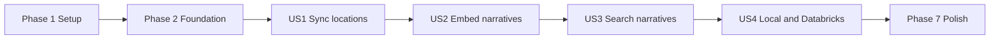

# Tasks: Weather Vector Search

**Input**: Design documents from `specs/001-weather-vector-search/`

**Prerequisites**: `plan.md`, `spec.md`, `research.md`, `data-model.md`,
`contracts/weather-api.yaml`, `contracts/frontend.md`, `quickstart.md`, and
`deployment.md`

**Automated tests**: Not included. The specification's FR-027 documents the learning-
exercise exception to Constitution Principle V. Tasks focus on implementation and the
manual end-to-end demonstrations described in the quickstart.

**Organization**: Tasks are grouped by the four P1 user stories. Shared project setup
and database foundations precede story implementation.

**Path conventions**: The repository uses a small root-level Python Flask application,
with `sql/`, `templates/`, `static/`, `notebooks/`, and `data/` at the repository root.

## Phase 1: Setup

**Purpose**: Establish dependencies, local configuration, and the development container
stack.

- [ ] T001 Create `requirements.txt` with Flask, Gunicorn, requests, psycopg2, pgvector, sentence-transformers, and databricks-sdk; do not add pytest or test-only dependencies.
- [ ] T002 [P] Add `.env.example`, `.gitignore`, and `.dockerignore`; document local-only variable names and exclude `.env`, `.venv`, downloaded `data/us_places.txt`, and model caches.
- [ ] T003 Create `Dockerfile` and `docker-compose.yml` with the planned Python app and `pgvector/pgvector:0.8.7-pg16-trixie` database service; gate app startup on database health, use a named volume, mount `sql/` read-only, bind the app port to `127.0.0.1`, and do not publish the database port.

## Phase 2: Foundational

**Purpose**: Create the shared database schema and connection boundary needed by the
weather sync, embedding, and search stories.

- [ ] T004 [P] Create `sql/weather_schema.sql` and enable the `vector` extension before creating the tables. For `weather_documents`, define a text primary-key `id`, required `location`, latitude and longitude within valid geographic ranges, required NWS grid fields, required `source_type` enum `alert` or `forecast`, `forecast_type` as `daily` or `hourly` for forecasts and null for alerts, nullable `headline`, required non-empty `narrative_text`, required `narrative_hash`, nullable `issued_at` and `effective_at`, required forecast `period_start` and `period_end` and null alert periods, original `payload` as `jsonb`, `synced_at`, and `embedding_status` enum `pending`, `current`, or `stale` defaulting to `pending`. For `weather_embeddings`, define a bigint identity ID, a cascading foreign key to `weather_documents.id`, zero-based `chunk_index` with `chunk_index >= 0`, non-empty `chunk_text` with 800-character chunks and 100-character overlap, `chunk_hash`, `vector(384)` embedding, `model_name`, `model_revision`, and `created_at`; enforce unique `(document_id, chunk_index)` and add document B-tree and cosine HNSW indexes.
- [ ] T005 [P] Implement `lakebase.py` with the `get_connection()` context manager and `RealDictCursor`; support local `DATABASE_URL` and Databricks `PG*` settings, obtain a fresh Lakebase OAuth credential for each new Psycopg 2 connection, require Lakebase SSL, and never log secrets or tokens.

**Checkpoint**: Shared schema and connection setup are ready before story work begins.

## Phase 3: User Story 1 - Sync Weather for Selected Locations (Priority: P1)

**Goal**: Let users select locations in the frontend and synchronize normalized,
location-specific NWS alert and forecast documents.

**Independent Demonstration**: Open the local page, add a city/state and a coordinate
location, synchronize them, and review each location's outcome, document count, and any
request-budget exhaustion.

- [ ] T006 [P] [US1] Implement `weather_client.py` to load the pinned Census Gazetteer, resolve exact city/state matches, validate coordinates in the ranges latitude -90 to 90 and longitude -180 to 180, normalize coordinates to at most four decimal places, resolve NWS `/points`, follow returned daily/hourly forecast URLs, fetch point-specific alerts, and normalize documents with stable IDs, labeled alert description/instruction, source payloads, and available timestamps. Enforce at most 20 outbound NWS request attempts per location per sync, including retries; pace NWS Alerts service requests at no more than one request every 30 seconds across the process; honor cache headers and other rate guidance; and report when that location's budget stops retrieval.
- [ ] T007 [P] [US1] Add weather-document upsert operations in `lakebase.py` keyed by stable `id`; create new documents with `embedding_status = 'pending'`, mark changed narratives `stale`, preserve current embeddings on metadata-only updates, and retain source provenance and timestamps.
- [ ] T008 [US1] Implement `GET /` and `POST /weather/sync` in `app.py`; accept city/state strings and `{ "lat": number, "lon": number }` objects, default `limit` to 50 documents per request and cap the total synchronized documents at the supplied limit, process valid locations despite other location failures, report each location's result and request-budget exhaustion, and return clear validation/operational errors without exposing credentials.
- [ ] T009 [P] [US1] Create `templates/index.html`, `static/weather.js`, and `static/weather.css` for the location workflow: add/remove multiple city/state or coordinate entries, validate required input, submit `POST /weather/sync`, prevent duplicate pending submissions, and display per-location status, document count, partial failures, and request-budget exhaustion with accessible labels and status messages.

## Phase 4: User Story 2 - Prepare Weather Narratives for Search (Priority: P1)

**Goal**: Convert synchronized narratives into compatible, traceable searchable chunks.

**Independent Demonstration**: Synchronize a document, run the embedding batch process,
and confirm that its chunk records link to the document and its embedding status becomes
current only after reconciliation completes.

- [ ] T010 [US2] Implement `weather_embeddings.py` with deterministic 800-character sliding-window chunks and 100-character overlap, at least one chunk for shorter narratives, stable chunk ordering and hashes, a pinned `sentence-transformers/all-MiniLM-L6-v2` revision, one encoder load per process, and validation of exactly 384 numeric finite values.
- [ ] T011 [US2] Implement `notebooks/ingest_weather_embeddings.py` to read pending/stale `weather_documents` through `lakebase.py`, register pgvector's Psycopg 2 adapter, reuse unchanged chunks for the same model revision, batch writes with `psycopg2` and `execute_values` or conflict-safe inserts, cast vectors explicitly, and reconcile obsolete/changed chunks in one transaction. Mark a document current only after its complete expected chunk set is stored; do not use Spark JDBC.

## Phase 5: User Story 3 - Search Weather Narratives (Priority: P1)

**Goal**: Let users enter a natural-language query and review ranked weather passages
with source and freshness metadata.

**Independent Demonstration**: After embedding documents, enter a query in the browser
page and review the ranked matches, source type, location, similarity, and applicable
timestamps; observe the clear empty state if no searchable embeddings exist.

- [ ] T012 [P] [US3] Implement `POST /weather/search` in `app.py`; reuse the process-level encoder, reject missing, blank, or malformed queries and non-numeric `top_k`, default `top_k` to 5 and clamp numeric values to 1–20, return an empty match list when no current embeddings exist, search only current compatible embeddings with `ORDER BY embedding <=> %s::vector LIMIT %s`, calculate similarity as one minus cosine distance, and return `document_id`, `source_type`, `location`, `headline`, `chunk_text`, `similarity`, `synced_at`, `issued_at`, `effective_at`, `period_start`, and `period_end`, representing unavailable/inapplicable timestamps as null.
- [ ] T013 [P] [US3] Extend `templates/index.html`, `static/weather.js`, and `static/weather.css` with the semantic-search form; submit the query to `POST /weather/search`, display returned matches in relevance order with all fields defined by `contracts/frontend.md`, render provider text as text rather than HTML, and show clear validation, request-error, and empty-result states.

## Phase 6: User Story 4 - Run Locally and Deploy to Databricks (Priority: P1)

**Goal**: Demonstrate the full local workflow and make the same application deployable as
a Lakebase-backed Databricks App.

**Independent Demonstration**: Start the local Compose stack without Databricks
credentials, use the browser page to sync and search after embedding, then follow the
deployment guide to demonstrate the same flow for an authorized workspace user when
Databricks resources are available.

- [ ] T014 [P] [US4] Add root `app.yaml` to run the Flask application through Gunicorn on `0.0.0.0` and `DATABRICKS_APP_PORT`; configure only non-secret app settings, including `LAKEBASE_ENDPOINT`, and rely on the Lakebase resource for injected `PG*` and managed app-identity credentials.
- [ ] T015 [P] [US4] Create `README_WEATHER.md` documenting the NWS source choice, schema, 800/100 chunking, model/dimensions, frontend location and search workflows, the 20-request-per-location cap, NWS alert-request pacing and cache guidance, local Compose setup, sync→embed→search instructions, Lakebase SQL/deployment steps, workspace permissions, known limitations, and the learning-exercise testing waiver.
- [ ] T016 [US4] Demonstrate the local workflow using `specs/001-weather-vector-search/quickstart.md` and the deployment workflow in `specs/001-weather-vector-search/deployment.md`; confirm the frontend experience, per-location request-budget status, current search metadata, and persistence across database container recreation without deleting the named volume.

## Phase 7: Polish and Cross-Cutting Concerns

**Purpose**: Keep operational diagnostics, local and deployed security boundaries, and
published documentation consistent.

- [ ] T017 Review `.gitignore`, `.dockerignore`, `docker-compose.yml`, `app.yaml`, `sql/weather_schema.sql`, and `README_WEATHER.md`; ensure local secrets and Gazetteer data are excluded, local access is loopback-only, Databricks access is permission-scoped, and documented DDL/grants match the executable schema.
- [ ] T018 Review `specs/001-weather-vector-search/contracts/weather-api.yaml`, `specs/001-weather-vector-search/contracts/frontend.md`, `specs/001-weather-vector-search/quickstart.md`, and `specs/001-weather-vector-search/deployment.md` against the implemented sync limit, per-location request cap, frontend behavior, and search freshness fields; update any mismatched documentation.
- [ ] T019 Implement actionable, secret-redacted operational logging with Python's standard `logging` module in `weather_client.py`, `app.py`, `weather_embeddings.py`, `notebooks/ingest_weather_embeddings.py`, and `lakebase.py`; for sync, search, embedding/reconciliation, and database connection/query failures, record the operation, failure category, and safe location/document identifiers where available, include sanitized exception context, and preserve existing error propagation and API contracts. Omit or redact credentials, OAuth tokens, DSNs, request headers, raw provider payloads, and SQL parameter values from log records.

## Dependencies and Execution Order



### Phase Dependencies

- **Setup (Phase 1)**: No dependencies; creates the Python project and local container
  stack.
- **Foundational (Phase 2)**: Depends on Setup; the shared schema and connection helper
  block all user stories.
- **US1 (Phase 3)**: Depends on Foundation; creates source documents required by embedding
  and search.
- **US2 (Phase 4)**: Depends on US1 documents and database upsert behavior.
- **US3 (Phase 5)**: Depends on US2's compatible embeddings and US1's browser shell.
- **US4 (Phase 6)**: Depends on US1–US3 for the complete local and deployed workflow.
- **Polish (Phase 7)**: Depends on the desired stories being complete.

### Parallel Opportunities

- T001 and T002 modify separate setup files and can proceed in parallel.
- T004 and T005 modify separate foundational files and can proceed in parallel.
- Within US1, T006, T007, and T009 affect separate files and can proceed in parallel;
  T008 integrates the client and database behavior.
- Within US3, T012 and T013 affect separate backend/frontend files and can proceed in
  parallel after US2 is complete.
- Within US4, T014 and T015 affect separate files and can proceed in parallel; T016
  requires the full pipeline.
- User stories are sequentially dependent: US2 requires US1, US3 requires US2, and the
  full US4 demonstration requires US1–US3.

### Parallel Examples by User Story

**US1**

```text
Task T006: NWS client and normalization in weather_client.py
Task T007: Weather-document persistence operations in lakebase.py
Task T009: Location entry and synchronization UI in templates/index.html, static/weather.js, and static/weather.css
After those tasks:
Task T008: Sync endpoint integration in app.py
```

**US2**

```text
Task T010: Chunking and model encoding in weather_embeddings.py
Then:
Task T011: Psycopg 2 batch reconciliation in notebooks/ingest_weather_embeddings.py
```

**US3**

```text
Task T012: Semantic-search endpoint in app.py
Task T013: Search form and result display in templates/index.html, static/weather.js, and static/weather.css
```

**US4**

```text
Task T014: Databricks app runtime configuration in app.yaml
Task T015: Local and Databricks runbook in README_WEATHER.md
Then:
Task T016: Manual local/deployment demonstration using quickstart.md and deployment.md
```

## Implementation Strategy

### MVP First

1. Complete Setup and Foundation.
2. Complete US1 to deliver location-based NWS synchronization through the browser.
3. Continue with US2 and US3 to complete the required sync → embed → semantic-search
   learning flow.
4. Complete US4 for reproducible local execution and Databricks deployment guidance.

### Incremental Delivery

1. Setup + Foundation: runnable local scaffold, schema, and connection boundary.
2. US1: normalized weather documents, request-budget enforcement, and location UI.
3. US2: transactional chunk and embedding batch pipeline.
4. US3: search endpoint and browser search/results interface.
5. US4: local Compose workflow and Databricks Apps/Lakebase deployment.
6. Polish: align configuration boundaries and feature documentation.

## Notes

- All implementation tasks use `- [ ] Tnnn [P?] [USn?] ...`; story tasks include their
  user-story label, while setup, foundational, and polish tasks do not.
- `[P]` marks work on separate files that can proceed after its stated prerequisites.
- Automated test tasks are intentionally omitted under spec FR-027; the quickstart and
  user-story demonstrations are not requirements to add test suites or fixtures.
